# Assignment #6 — jQuery (Selectors, Effects, Animations)

**Student:** Korganbek Madiyar  
**Group:** IT-2501

## Project Description

This project demonstrates the use of jQuery for DOM manipulation, event handling, CSS styling, visual effects, and animations.

The portfolio includes interactive elements that demonstrate jQuery selectors, visibility methods, fading effects, sliding panels, adding and removing elements, modifying attributes, form interaction, and basic animations.

## Task 0 — jQuery Setup

jQuery is included using a CDN. The `$(document).ready()` function ensures that the code runs after the document has loaded.

**Screenshot:**

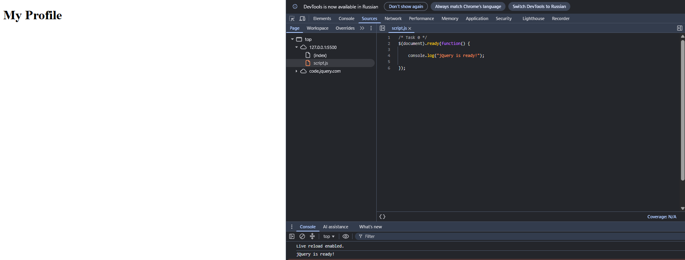

## Task 1 — Selectors & CSS

This task demonstrates jQuery selectors, text manipulation, and CSS styling. It also includes buttons for switching between light and dark themes.

**Screenshots:**

1. Initial portfolio page:

2. Changing the greeting:

3. Light theme:

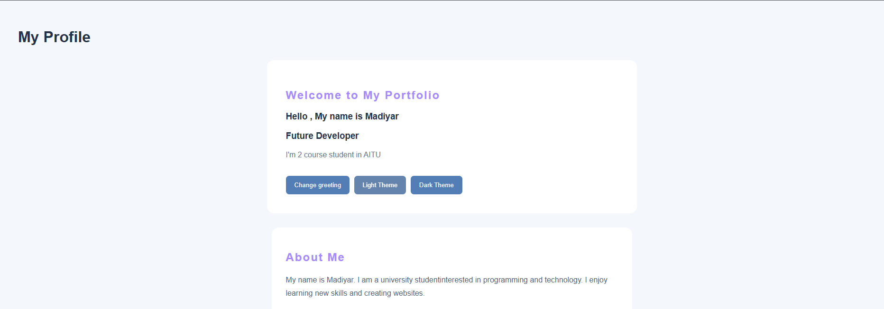

4. Dark theme:

## Task 2 — Visibility Methods

This task demonstrates the `.hide()`, `.show()`, and `.toggle()` methods to control the visibility of personal information.

**Screenshots:**

1. Hide personal information:

2. Show personal information:

3. Toggle visibility:

## Task 3 — Fade Methods

This task demonstrates fading effects using `.fadeIn()`, `.fadeOut()`, and `.fadeToggle()` to control the visibility of gallery images.

**Screenshots:**

1. Fade in images:

2. Fade out images:

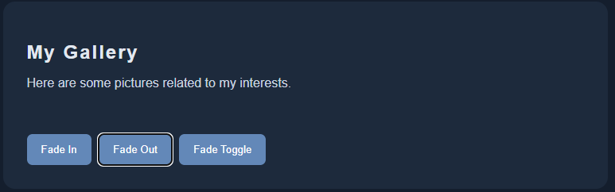

3. Toggle fading:

## Task 4 — Slide Methods

This task demonstrates sliding effects using `.slideDown()`, `.slideUp()`, and `.slideToggle()` to open and close collapsible panels.

**Screenshots:**

1. Open all panels:

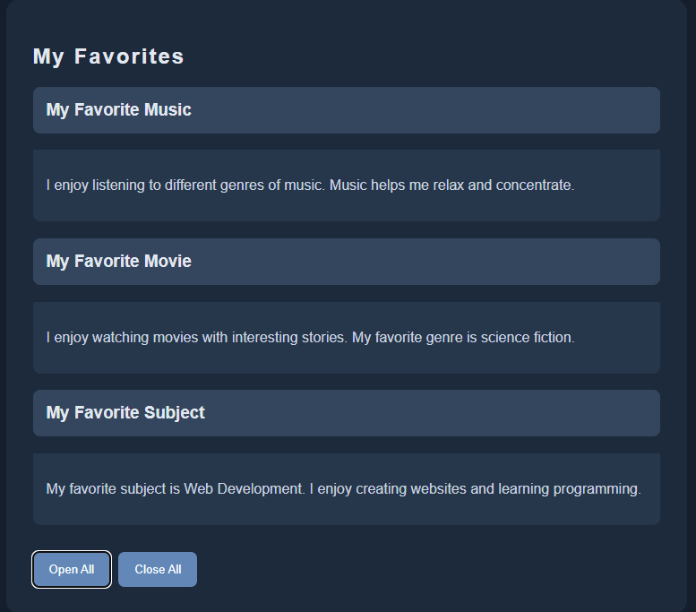

2. Close all panels:

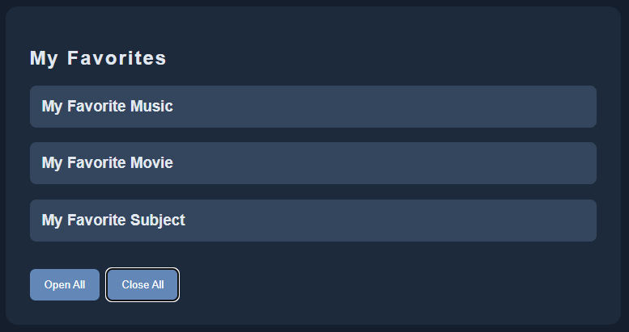

## Task 5 — Add & Remove Elements

This task demonstrates how to dynamically manage a list of technical skills using `.append()`, `.prepend()`, and `.remove()`.

**Screenshots:**

1. Initial skills list:

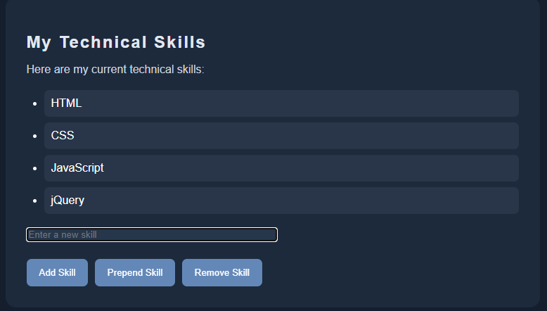

2. Add a new skill using `.append()`:

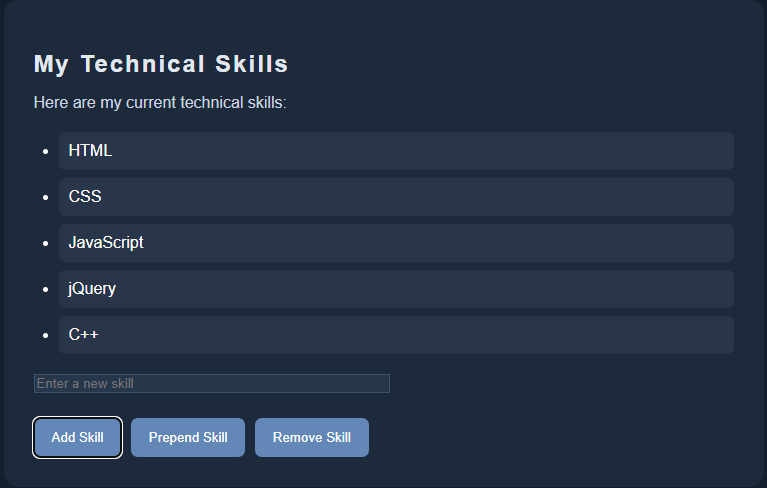

3. Add a skill at the beginning using `.prepend()`:

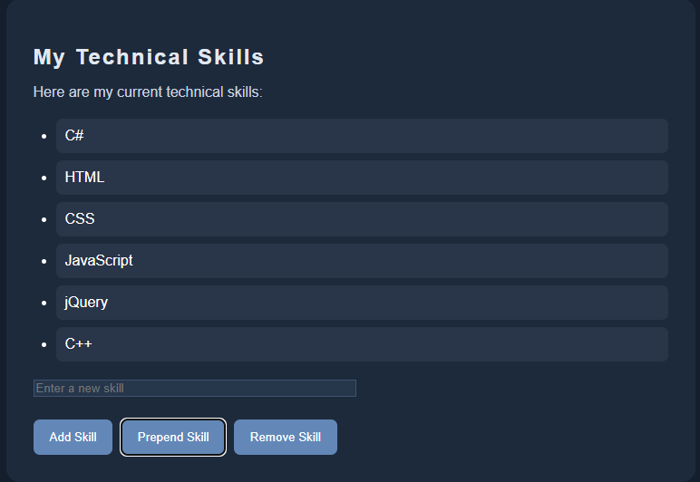

4. Remove the last skill using `.remove()`:

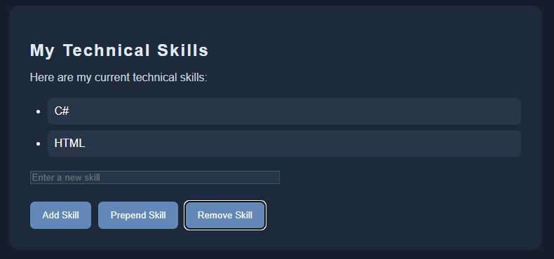

## Task 6 — Modifying Attributes

This task demonstrates how to dynamically change a social media link using the jQuery `.attr()` method.

**Screenshots:**

1. Initial social media link:

2. Changed social media link:

## Task 7 — Form Interaction

This task demonstrates how to retrieve input values using `.val()` and display them dynamically using `.text()`.

**Screenshots:**

1. Empty form:

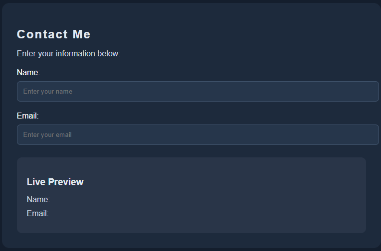

2. Form with entered information:

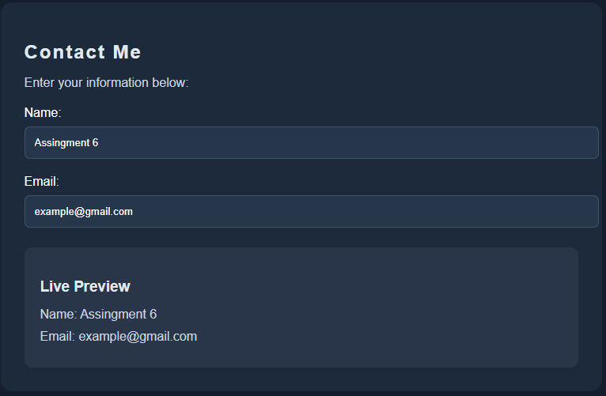

## Task 8 — Basic Animation

This task demonstrates the jQuery `.animate()` method. Skill bars start with zero width and expand to different widths when the animation button is clicked. Clicking the button again resets the bars.

**Screenshots:**

1. Initial skill bars with zero width:

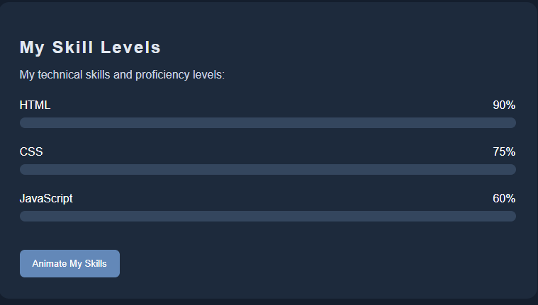

2. Animated skill bars:

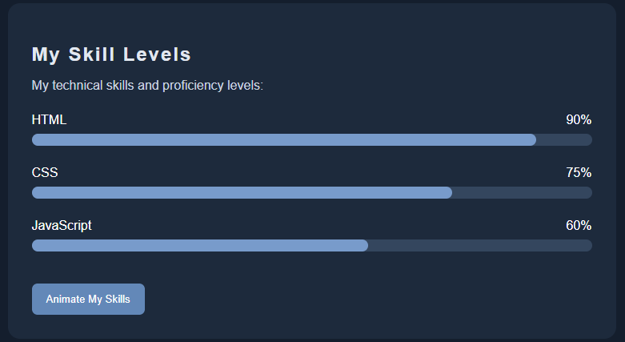

## Work Process Summary

During this assignment, I created a personal portfolio and practiced using jQuery for interactive web development.

I learned how to:

- Select HTML elements using tag, ID, and class selectors.
- Change text and CSS properties dynamically.
- Implement light and dark themes.
- Control element visibility using hide, show, and toggle methods.
- Apply fading and sliding effects.
- Add, prepend, and remove HTML elements dynamically.
- Modify HTML attributes using `.attr()`.
- Work with form inputs using `.val()` and `.text()`.
- Create animations using `.animate()`.

The project helped me understand how jQuery simplifies DOM manipulation and makes web pages more interactive.